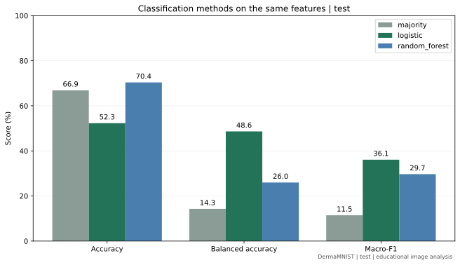

# 实验结果

DermaMNIST 64×64，train=7007、val=1003、test=2005。Python 3.12.14，scikit-learn 1.9.1。

## 成绩

| 分区 | 模型 | Accuracy | Balanced accuracy | Macro-F1 |
|---|---|---:|---:|---:|
| val | 多数类基线 | 0.6690 | 0.1429 | 0.1145 |
| val | 逻辑回归 | 0.5165 | 0.4940 | 0.3714 |
| val | 随机森林 | 0.7238 | 0.2794 | 0.3148 |
| test | 多数类基线 | 0.6688 | 0.1429 | 0.1145 |
| test | 逻辑回归 | 0.5232 | 0.4865 | 0.3611 |
| test | 随机森林 | 0.7037 | 0.2598 | 0.2970 |

随机森林在2005张测试图像中预测正确1411张，逻辑回归为1049张，多数类基线为1341张。森林的准确率最高，逻辑回归的balanced accuracy和macro-F1更高。



原始精度的汇总数值见[results.csv](assets/results.csv)。

## 特征

每张图像生成24个数：RGB各通道均值和标准差6维，灰度均值和标准差2维，16个固定灰度区间的像素比例16维。

RGB与灰度统计量除以255，标准差使用ddof=0。灰度采用Pillow的L模式，直方图区间为[0,256)，每格宽16。特征名称和顺序见 `features.py`。

## 模型参数

- 多数类基线：只预测train中数量最多的类别。
- 逻辑回归：StandardScaler加LogisticRegression，缩放器和分类器仅拟合train。`class_weight=balanced`，`solver=lbfgs`，`max_iter=3000`，`tol=1e-4`。在C=0.1、1、10中按val macro-F1选择，平分时选较小C，最终C=10。
- 随机森林：300棵树，`max_features=sqrt`，`bootstrap=True`，`random_state=42`，`n_jobs=2`。按val accuracy选择；平分时依次比较macro-F1、balanced accuracy和候选顺序。最终 `max_depth=12`、`min_samples_leaf=1`、`class_weight=None`。

森林不做标准化。两种分类器都不合并train和val重训，使用相同特征和测试图像。

## 森林候选

| max_depth | min_samples_leaf | class_weight | Val accuracy | Val macro-F1 |
|---|---:|---|---:|---:|
| 12 | 3 | None | 0.7228 | 0.2870 |
| 12 | 3 | balanced_subsample | 0.6720 | 0.4264 |
| 12 | 1 | None | 0.7238 | 0.3148 |
| 12 | 1 | balanced_subsample | 0.6899 | 0.3776 |
| None | 3 | None | 0.7188 | 0.2897 |
| None | 3 | balanced_subsample | 0.7208 | 0.4222 |
| None | 1 | None | 0.7188 | 0.3023 |
| None | 1 | balanced_subsample | 0.7159 | 0.2836 |

平衡权重候选在验证集上有更高的macro-F1。本轮按准确率选参，保留全部候选记录，没有根据test更换配置。

## 复现

```bash
.venv/bin/python -m pip install -r requirements-ml-lock.txt
.venv/bin/python train_baseline.py --offline --random-forest --evaluate-test
```

首次运行需先用 `.venv/bin/python main.py` 下载数据。输出目录为 `outputs/random_forest/test_evaluation/`；不加 `--evaluate-test` 时只输出val结果。

`experiment.json` 保存完整参数、版本、标准化统计量和成绩。逐图预测、逐类指标、混淆矩阵及候选表保存在同一目录。不纯度特征重要性描述森林的分裂情况，不表示因果贡献。

## 数据检查

原始RGB像素审计发现train内1个重复组、val内1个重复组，跨分区精确重复组和标签冲突组均为0，没有自动删除图像。

评估沿用原官方分区，存在同病灶照片跨集合的已知问题，像素哈希检查不能排除这种重叠。test已在前轮实验中查看，本次成绩属于同分区的探索比较。数据来源与研究引用见[数据说明](数据说明.md)。
